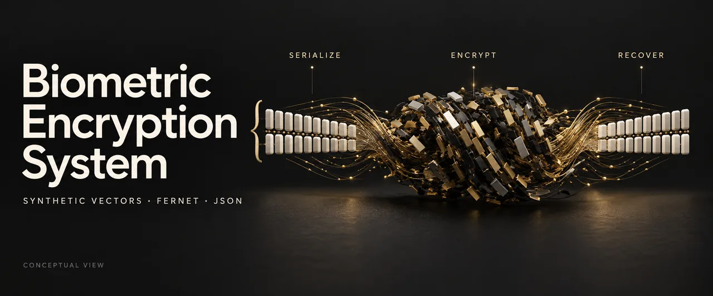

# Biometric Encryption System



*Conceptual illustration, not program output.*

A small Fernet encryption round-trip demonstration for synthetic numerical vectors.

## Problem and objective

Demonstrate serialization, symmetric encryption, local JSON writing, and recovery of the original vector within the same Python process.

## Scope and limitations

Vectors are synthetic and are not facial, fingerprint, or voice templates. This is not a biometric authentication system or a persistent secure storage service.

**The key is generated in memory when `crypto_manager.py` is imported. It is not saved. After the process exits, its stored tokens cannot be recovered by a new process using a newly generated key.** Retaining the JSON does not retain the key. Each call to `store_user_vector` replaces the entire JSON file, including any previous user entry. Rerunning `main.py` replaces the demonstration data.

No key management, rotation, access control, multi-user persistence, or recovery procedure is implemented. Persistent key storage would change the security design and remains future work.

## How it works

NumPy vector → JSON bytes → Fernet token → `data/encrypted_data.json` → decrypt with the current process key → compare arrays. The script creates the output directory on a fresh clone.

## Technologies

Python, NumPy, cryptography (Fernet), standard-library JSON.

## Installation and configuration

Use Python 3.11. From the repository root:

```powershell
python -m venv .venv
.venv/Scripts/python -m pip install -r requirements-lock.txt
```

`requirements-lock.txt` records the reviewed environment; `requirements.txt` lists direct dependencies.

On macOS/Linux, replace `.venv/Scripts/python` with `.venv/bin/python`.

## Run and example output

```powershell
.venv/Scripts/python main.py
```

```text
Ephemeral key: recovery is limited to this process.
Round-trip matches: True
```

## Data source

A seeded 128-dimensional synthetic vector; no sensitive data is required.

## Verification

```powershell
.venv/Scripts/python -m unittest discover -s tests -v
```

Verified with Python 3.11.9: three unit tests and the demo passed. Tests check the round trip, rejection with a different key, and the documented replacement of a previous user entry.

## Possible next steps

A separate design could introduce managed keys and intentional update semantics, with recovery and access-control tests before making persistent-storage claims.
